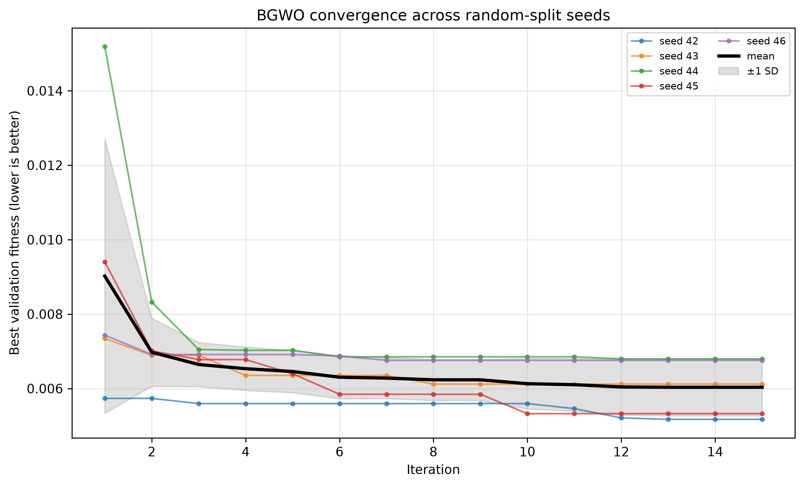
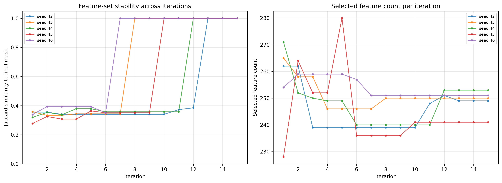

# Leakage-Safe Random Forest + Binary Grey Wolf Optimizer for SQL Injection Detection

A reproducible, leakage-safe machine-learning pipeline for SQL-injection (SQLi) detection. The pipeline combines TF-IDF text features, a Random Forest (RF) classifier, and a Binary Grey Wolf Optimizer (BGWO) for feature selection, with an optional 13-feature model derived from RF feature importance.

The test partition is never used for vectorizer fitting, feature selection, feature ranking, or hyperparameter tuning. The TF-IDF vocabulary is fitted on the fit subset only, BGWO optimizes validation fitness, and test data is used once for final scoring.

## Highlights

- **Leakage-safe protocol:** stratified train/test split first; validation and fit subsets are carved only from the training partition.
- **Interpretable features:** word-level TF-IDF (1-2 grams, 512 features) instead of padded token positions.
- **BGWO feature selection:** sigmoid-transfer binary GWO with validation-based fitness.
- **Top-13 model:** the BGWO-selected features are ranked by RF importance on the fit subset, and the 13 most important features are retained.
- **Five-seed repeated holdout:** mean, standard deviation, and 95% confidence intervals for random and template-grouped splits.
- **Strong baselines:** Logistic Regression and Linear SVM on word and character n-gram TF-IDF.
- **Leakage audit:** normalized query templates reveal that 28.13% of random-split test rows (52.87% of injection rows) share a template with training; a template-grouped evaluation is provided as a stricter check.
- **Error analysis:** false positives/negatives with heuristic attack-family proxies.
- **Publication artifacts:** convergence/stability figures at 300 DPI, McNemar test, environment details, and a checklist summary.

## Dataset

`Modified_SQL_Dataset_Strip.csv` contains two columns:

| Column | Description |
|---|---|
| `Query` | SQL query string |
| `Label` | `0` = benign, `1` = SQL injection |

Cleaning and class counts:

| Stage | Rows |
|---|---|
| Raw CSV | 22,916 |
| After removing missing labels / empty queries / exact `(Query, Label)` duplicates | **22,859** |
| Benign (`0`) | 11,581 |
| SQL injection (`1`) | 11,278 |

- Exact duplicate queries remaining: **0**
- Queries with conflicting labels: **0**
- 57 duplicate rows removed

The included CSV is the exact file used in all reported experiments. Check the original dataset's license and terms before redistributing it.

## Methodology

### Leakage-safe split

1. Stratified 70/30 train/test split (`random_state=42` for the base notebooks; seeds `42..46` for the publication checks).
2. A 20% validation subset is carved from the training partition only.
3. TF-IDF is fitted on the fit subset (80% of training) and applied to validation, training, and test.
4. BGWO fitness is computed on validation data only.
5. The test partition is used once for final evaluation.

### TF-IDF

- Word analyzer, lowercase, token pattern `(?u)\b\w+\b`
- 1-2 grams
- `max_features=512`
- sublinear TF scaling

### BGWO

- Population: 8 wolves
- Iterations: 15
- Binary transfer: sigmoid
- Fitness: `0.99 * (1 - validation accuracy) + 0.01 * (selected features / total features)`
- Fitness RF: 60 trees
- Empty masks are penalized; fitness evaluations are cached

### Top-13 variant

After BGWO selects a subset (typically 241-253 features), an RF is trained on the fit subset using the selected features. Features are ranked by impurity-based importance, and the top 13 are frozen before test evaluation.

Seed-42 top-13 features:

```text
from, select, and, all select, all, 1 and, 1 select, 5, union, where, 1 or, when, case when
```

Final models use 200 trees, `class_weight="balanced_subsample"`, and `max_features="sqrt"`.

## Results

### 1. Seed 42, random holdout (6,858 test rows)

| Model | Features | Accuracy | Precision | Recall | Specificity | F1 | ROC-AUC |
|---|---:|---:|---:|---:|---:|---:|---:|
| Baseline RF | 512 | 0.99810 | 0.99852 | 0.99764 | 0.99856 | 0.99808 | 0.99951 |
| RF + BGWO | 249 | 0.99723 | 0.99675 | 0.99764 | 0.99683 | 0.99719 | 0.99961 |
| RF + BGWO top-13 | 13 | 0.98542 | 0.97457 | 0.99645 | 0.97467 | 0.98539 | 0.99798 |

### 2. Five-seed random holdout (mean ± std)

| Model | Features | Accuracy | F1 | ROC-AUC |
|---|---:|---:|---:|---:|
| Baseline RF | 512 | 0.99848 ± 0.00056 | 0.99846 ± 0.00057 | 0.99988 |
| RF + BGWO | 248.8 (241-253) | 0.99770 ± 0.00066 | 0.99767 ± 0.00067 | 0.99962 |
| RF + BGWO top-13 | 13 | 0.98848 ± 0.00727 | 0.98846 ± 0.00725 | 0.99831 |
| Logistic Regression (word) | 512 | 0.99638 ± 0.00047 | 0.99634 ± 0.00047 | 0.99938 |
| Linear SVM (word) | 512 | 0.99781 ± 0.00075 | 0.99778 ± 0.00076 | 0.99932 |
| Logistic Regression (char 3-5) | 5,000 | 0.99764 ± 0.00044 | 0.99760 ± 0.00045 | 0.99962 |
| Linear SVM (char 3-5) | 5,000 | 0.99848 ± 0.00039 | 0.99846 ± 0.00040 | 0.99952 |

Full metrics and confidence intervals: `publication_checks_artifacts/multiseed_summary.csv`.

### 3. Five-seed template-grouped holdout (mean ± std)

`GroupShuffleSplit` on normalized query templates guarantees zero template overlap between train and test. The validation subset is also carved by groups.

| Model | Features | Accuracy | F1 | ROC-AUC |
|---|---:|---:|---:|---:|
| Baseline RF | 512 | 0.98826 ± 0.00911 | 0.98836 ± 0.00906 | 0.99977 |
| RF + BGWO | 248.2 (242-252) | 0.99017 ± 0.00965 | 0.99042 ± 0.00922 | 0.99962 |
| RF + BGWO top-13 | 13 | 0.97811 ± 0.00809 | 0.97833 ± 0.00743 | 0.99788 |

Per-seed metrics: `publication_checks_artifacts/group_split_metrics.csv` (also `group_multiseed_metrics.csv`). Full summary: `group_multiseed_summary.csv`.

### 4. Top-13 feature stability (5 seeds)

| Feature | Seeds present | Frequency |
|---|---:|---:|
| `select` | 5 / 5 | 100% |
| `where` | 4 / 5 | 80% |
| `from`, `and`, `all`, `1 select`, `5`, `union`, `1 or`, `else` | 3 / 5 | 60% |

Pairwise Jaccard overlap of top-13 sets: mean **0.233** (min 0.083, max 0.444). The exact 13-feature set is therefore seed-dependent, although `select` is consistently retained. Full table: `top13_stability.csv`.

### 5. McNemar's test — baseline RF vs RF + BGWO (seed 42)

| Discordant pairs | Count |
|---|---:|
| Baseline correct / BGWO wrong (`b`) | 6 |
| Baseline wrong / BGWO correct (`c`) | 0 |
| Total discordant (`b + c`) | 6 |

- Continuity-corrected chi-square p-value: **0.04123**
- Exact two-sided binomial p-value: **0.03125**

The difference is statistically significant at α = 0.05, but it rests on only 6 discordant predictions. Full result: `mcnemar_results.csv`.

### 6. Error analysis by heuristic attack family (seed 42, top-13 model)

The dataset has no ground-truth attack-family labels, so families are keyword-based proxies and are indicative only.

- Test rows: 6,858
- False positives: 88
- False negatives: 12
- Missed injections by proxy family: time-based 3, other 4, comment/obfuscation 3, error/out-of-band 2; boolean/tautology, union-based, and stacked 0.

Full table: `attack_family_fn.csv`; examples: `fp_fn_examples.csv`.

## Figures





Both figures are saved at 300 DPI.

## Reproducibility

### Environment

| Component | Version / value |
|---|---|
| OS | Windows 11 (build 26200) |
| Python | 3.13.15 |
| scikit-learn | 1.9.1 |
| pandas | 2.3.3 |
| NumPy | 2.5.3 |
| SciPy | 1.18.1 |
| matplotlib | 3.11.2 |
| joblib | 1.6.0 |
| psutil | 7.2.2 |
| CPU (logical) | 8 |
| RAM | 7.88 GB |

Full details: `publication_checks_artifacts/environment.json` and `sklearn_versions.txt`.

### Run

```bash
# From the repository root
jupyter nbconvert --to notebook --execute --inplace \
  RF_BGWO_Repaired_LeakageSafe.ipynb \
  --ExecutePreprocessor.kernel_name=python3

jupyter nbconvert --to notebook --execute --inplace \
  RF_BGWO_Repaired_LeakageSafe_13_Only.ipynb \
  --ExecutePreprocessor.kernel_name=python3

jupyter nbconvert --to notebook --execute --inplace \
  RF_BGWO_Publication_Checks.ipynb \
  --ExecutePreprocessor.kernel_name=python3
```

The notebooks read `Modified_SQL_Dataset_Strip.csv` from the current directory. The publication-checks notebook re-runs BGWO for five random seeds plus five template-grouped seeds; on an 8-logical-core CPU this takes roughly 15-20 minutes.

### Inference example

```python
import joblib
import numpy as np

bundle = joblib.load("rf_bgwo_top13_artifacts/inference_bundle_top13.joblib")
vectorizer = bundle["vectorizer"]
mask = bundle["top13_mask"]
model = bundle["top13_model"]

query = "select * from users where id=1 or 1=1"
features = vectorizer.transform([query])
prediction = int(model.predict(features[:, np.flatnonzero(mask)])[0])
probability = model.predict_proba(features[:, np.flatnonzero(mask)])[0, 1]

print("SQL injection" if prediction == 1 else "Benign", probability)
```

## Complexity

Let `N` = documents, `L` = average tokens, `V` = vocabulary size, `T` = trees, `n` = training rows, `d` = features, `P` = wolves, `I` = iterations, `D` = tree depth, and `K = 13`.

- TF-IDF: `O(N·L)`
- Random Forest training: `O(T·n·√d·log n)`; prediction `O(T·D·√d)` per query
- BGWO: `O(I·P·T_f·n_f·√d·log n_f)` worst case, reduced by fitness caching
- Top-13 ranking: one RF on the selected features
- Space: `O(nnz + V + T·n + P·d)`
- Inference with top-13: transform `O(L)`, predict `O(T·D·√K)`

A full Big-O discussion is included in Section 10 of `RF_BGWO_Publication_Checks.ipynb`.

## Limitations and responsible use

- **Single dataset:** all results come from one SQLi dataset. External or cross-dataset validation is not available and is marked as such in `checklist_summary.csv`. Do not claim generalization without an external test.
- **Template leakage:** 28.13% of random-split test rows share a normalized template with training (52.87% for injections). The template-grouped results are the more conservative estimate.
- **Statistical significance is not practical significance:** McNemar's test is based on very few discordant predictions.
- **Proxy attack families:** family labels are heuristic, not ground truth.
- **Test set consumption:** the test data is used for final evaluation only; do not tune on it.
- **Not production-ready:** a classifier does not replace parameterized queries, prepared statements, least privilege, and secure application design.
- **Dataset redistribution:** verify the original dataset's license before publishing the included CSV.

## License

No license file is included. Add an explicit license before publishing if you intend to permit reuse.
